# 🌸 Iris species classification

An end-to-end, reproducible study of how well four flower measurements predict Iris species. Explore the data, compare tuned classifiers, inspect model explanations, and review the saved outputs below.

| Dataset | Validation | Selected model | Hold-out macro F1 |
|:--|:--|:--|--:|
| 150 flowers · 3 balanced species | Stratified 5-fold CV + untouched 20% test split | Linear SVM · `C = 0.1` | **0.933** |

**Jump to:** [Research purpose](#research-purpose) · [Dataset and EDA](#dataset-and-eda) · [Methodology](#methodology) · [Results](#results) · [Explainability](#explainability) · [Monitoring](#monitoring) · [Reproduce](#reproduce)

## Research purpose

**Research question:** How accurately can Iris species be predicted from sepal and petal dimensions, and which measurements carry the most useful signal?

The goal is to make a fair, reproducible comparison of common multiclass classifiers on Fisher's classic Iris data. The analysis tests the familiar pattern that *Iris-setosa* is easy to separate, while *Iris-versicolor* and *Iris-virginica* overlap more. It is an educational benchmark, not a field-ready botanical identification system.

Historical context: [R. A. Fisher, “The Use of Multiple Measurements in Taxonomic Problems” (1936)](http://rcs.chemometrics.ru/Tutorials/classification/Fisher.pdf); the Iris dataset is also listed by the [UCI Machine Learning Repository](http://archive.ics.uci.edu/ml/).

## Dataset and EDA

The project uses [`Iris.csv`](Iris.csv), which contains 150 observations, four measurements in centimetres, a species label, and an `Id` record key. Each species contributes 50 rows. The identifier is not a biological measurement, so it is excluded from model inputs.

| Data check | Result | Interpretation |
|:--|--:|:--|
| Rows | 150 | Small benchmark dataset |
| Predictors | 4 | Sepal length/width and petal length/width |
| Missing predictor values | 0 | No imputation was required |
| Exact duplicate rows | 0 | No duplicate observations detected |
| Species counts | 50 / 50 / 50 | Balanced classes; no class reweighting needed |
| IQR flags | 4 on sepal width | Reviewed as descriptive flags; no rows removed |

### What the EDA shows

- **Petal measurements separate the species most clearly.** Average petal length rises from 1.46 cm for setosa, to 4.26 cm for versicolor, to 5.55 cm for virginica. Average petal width rises from 0.24 cm, to 1.33 cm, to 2.03 cm.
- **Petal length and petal width move together** (Pearson correlation **0.963**). That relationship is useful for prediction, although it means the two measurements are not independent evidence.
- **Setosa forms a distinct group.** The remaining overlap is mainly between versicolor and virginica, which is also where the selected model makes its two hold-out errors.
- **The classes are balanced.** Accuracy is informative here, while macro-averaged metrics still make each species count equally.
- **Four sepal-width values fall outside the overall 1.5×IQR fences.** On a small natural dataset, a statistical flag is not proof of bad data, so those observations were retained.

| Balanced classes | Measurements by species |
|:--:|:--:|
| 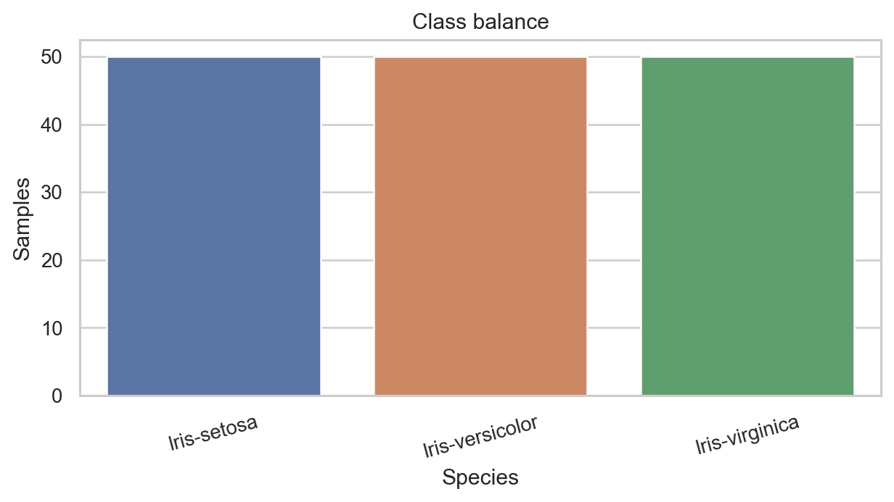 | 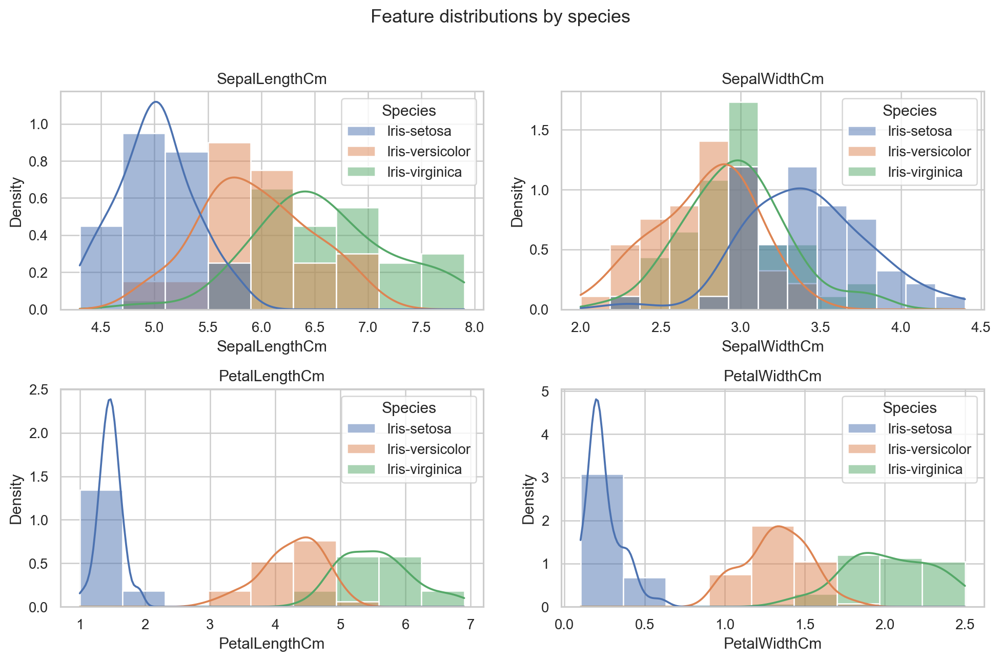 |

| Pairwise separation | Feature spread and outlier review |
|:--:|:--:|
| 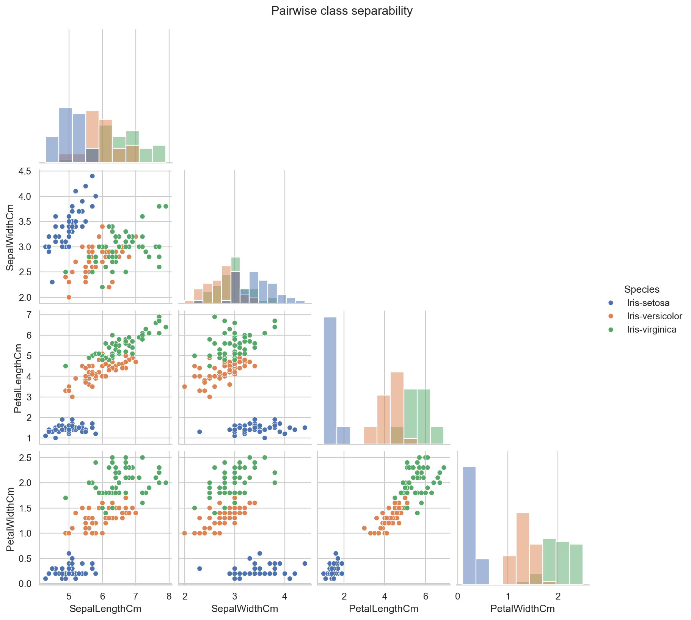 | 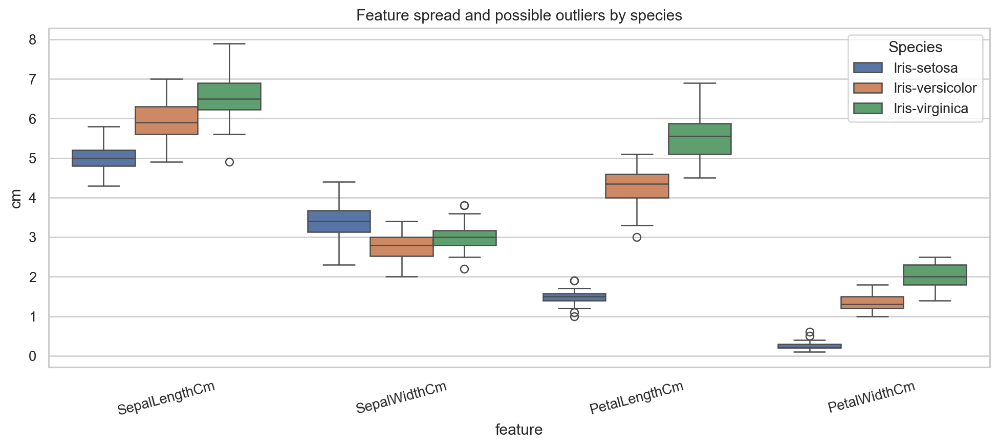 |

**Feature correlation**

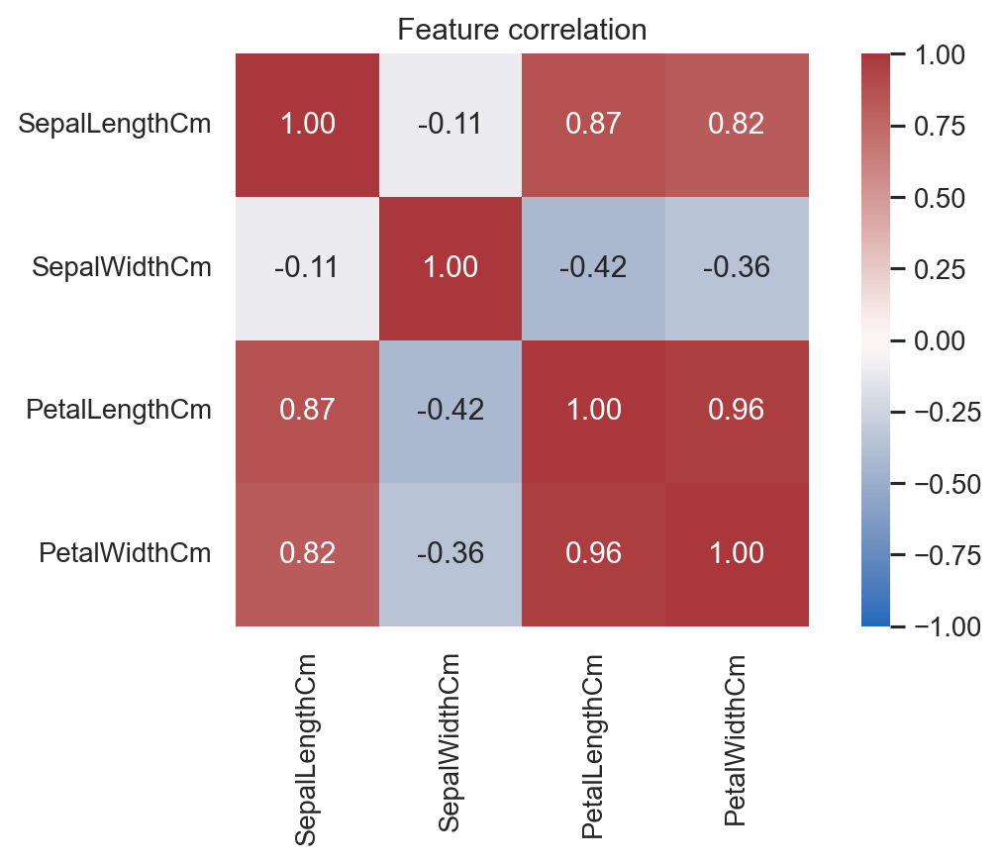

<details>
<summary>Open the original notebook's saved plots</summary>

These standalone image files were extracted from the preserved notebook outputs, including plots that previously existed only inside the `.ipynb` file.

**Missing-value heatmap**

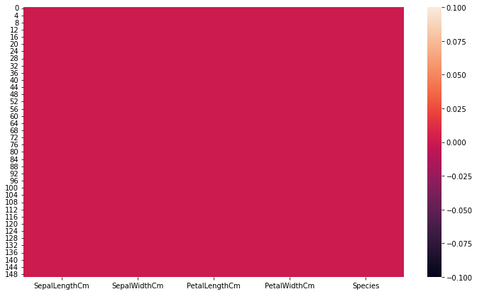

**Original feature histograms and correlation plot**

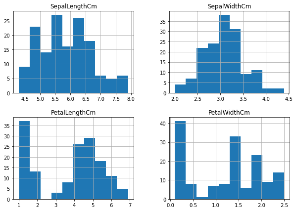

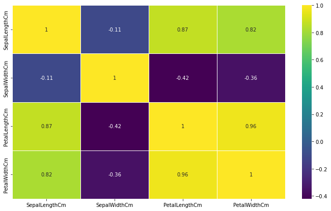

**Original species-count plot and KNN error curve**

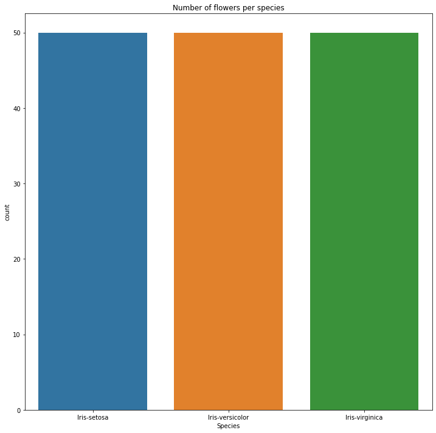

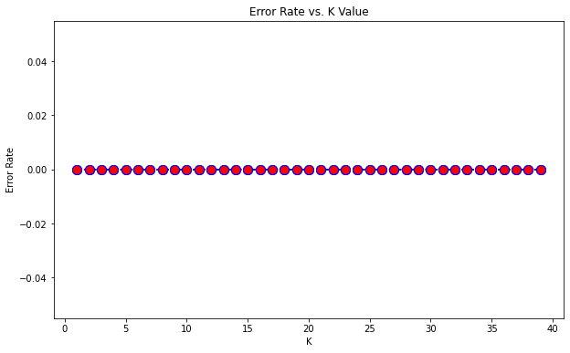

</details>

## Methodology

### Experimental design

1. **Keep the test set out of model selection.** A stratified 80/20 split creates 120 training rows and a 30-row hold-out set, with 10 examples per species in the test set.
2. **Tune within the training set.** Each candidate uses stratified 5-fold cross-validation. Every fold retains class balance, and the test data is not used to choose hyperparameters.
3. **Select by mean CV macro F1.** Macro F1 averages the per-species F1 scores, so the three classes contribute equally. Mean CV score is the primary rule; test results are reported afterward as an independent check.
4. **Scale only where it helps.** Standardization is fitted inside the Logistic Regression, KNN, and SVM pipelines because these models depend on feature scale. Random Forest uses the original measurements. Keeping preprocessing inside each pipeline prevents information from validation folds leaking into scaling.
5. **Explain and monitor the saved pipeline.** SHAP and permutation importance summarize feature influence; a training-set feature baseline supports later batch drift checks.

### Models and search ranges

| Model | Why it is included | Tuned settings |
|:--|:--|:--|
| Logistic Regression | Simple, interpretable linear baseline | Regularization `C`: 0.01, 0.1, 1, 10, 100 |
| K-Nearest Neighbors | Tests local, distance-based class boundaries | Neighbors: 3, 5, 7, 9, 11; uniform/distance weights; Manhattan/Euclidean distance |
| Random Forest | Captures nonlinear splits without scaling | 150/300 trees; unrestricted or depth 4; leaf size 1/2 |
| SVM | Tests linear and nonlinear boundaries on scaled features | Linear/RBF kernels; `C`: 0.1, 1, 10, 100; RBF gamma: scale/auto |

<details>
<summary>Why use these evaluation metrics?</summary>

- **Accuracy:** fraction of all predictions that are correct.
- **Balanced accuracy:** average recall across species; remains useful if future batches are imbalanced.
- **Macro precision, recall, and F1:** calculate the metric per species, then average the three scores equally.
- **Log loss:** evaluates predicted probabilities and penalizes confident wrong predictions; lower is better.
- **Confusion matrix:** shows which species are mistaken for which other species.

</details>

## Results

The linear SVM had the highest **mean cross-validation macro F1**, so it was selected before inspecting the hold-out results. Scores below are rounded to three decimals. The CV column shows mean ± fold standard deviation; the other scores come from the same untouched 30-row test set.

| Model | CV macro F1 (mean ± SD) | CV accuracy | Hold-out accuracy | Hold-out macro F1 | Hold-out log loss |
|:--|--:|--:|--:|--:|--:|
| **Linear SVM · selected** | **0.975 ± 0.020** | 0.975 | 0.933 | 0.933 | 0.152 |
| KNN | 0.967 ± 0.017 | 0.967 | 0.933 | 0.933 | 0.114 |
| Logistic Regression | 0.966 ± 0.032 | 0.967 | **1.000** | **1.000** | **0.083** |
| Random Forest | 0.966 ± 0.032 | 0.967 | 0.967 | 0.967 | 0.167 |

The Logistic Regression scored perfectly on this particular test split, while the SVM ranked first in cross-validation. The SVM remains the reported selected model because selection was defined in advance by CV macro F1; choosing the model after looking at test performance would make the test set part of model selection. On just 30 test examples, a one-flower difference changes accuracy by 3.3 percentage points.

### Selected model: hold-out evaluation

| Metric | Score |
|:--|--:|
| Accuracy | 0.933 |
| Balanced accuracy | 0.933 |
| Macro precision | 0.933 |
| Macro recall | 0.933 |
| Macro F1 | **0.933** |
| Log loss | 0.152 |

The selected SVM correctly classified **28 of 30** hold-out flowers. Setosa was classified perfectly; one versicolor was called virginica and one virginica was called versicolor.

| Actual / Predicted | Setosa | Versicolor | Virginica |
|:--|--:|--:|--:|
| Setosa | 10 | 0 | 0 |
| Versicolor | 0 | 9 | 1 |
| Virginica | 0 | 1 | 9 |

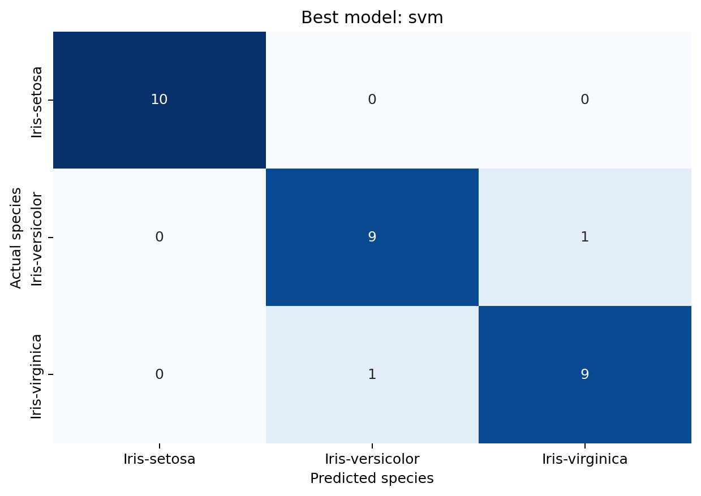

<details>
<summary>Show per-species hold-out precision, recall, and F1</summary>

| Species | Precision | Recall | F1 | Support |
|:--|--:|--:|--:|--:|
| Iris-setosa | 1.000 | 1.000 | 1.000 | 10 |
| Iris-versicolor | 0.900 | 0.900 | 0.900 | 10 |
| Iris-virginica | 0.900 | 0.900 | 0.900 | 10 |

</details>

## Explainability

Both explanation methods put the petal measurements first. SHAP values below are mean absolute contributions to the selected linear SVM's model score; they describe model behavior and do not imply that a measurement causes a species.

| Feature | Mean absolute SHAP value | Hold-out permutation importance |
|:--|--:|--:|
| Petal width | 0.6104 | 0.2438 ± 0.0832 |
| Petal length | 0.5721 | 0.2259 ± 0.0831 |
| Sepal length | 0.1884 | -0.0042 ± 0.0303 |
| Sepal width | 0.1225 | 0.0234 ± 0.0358 |

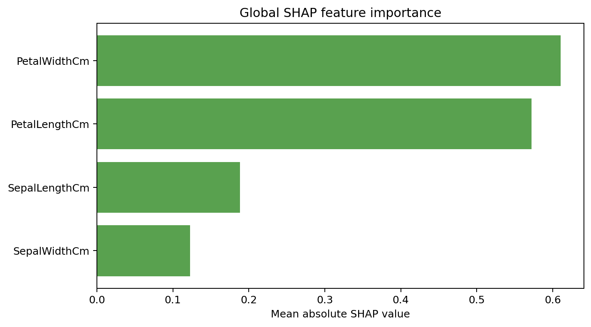

The agreement between SHAP and permutation importance supports the EDA finding that petal width and length carry the strongest predictive signal. The small, near-zero permutation scores for the sepal measurements indicate little measurable benefit from shuffling those features on this hold-out set.

## Monitoring

The scoring script writes class probabilities, prediction confidence, predicted-class proportions, optional labelled metrics, and feature drift compared with the training baseline. Population Stability Index (PSI) is treated as a review signal: it describes feature-distribution movement, not model accuracy.

The workflow was demonstrated on the supplied Iris file. That same-source batch had a maximum PSI of **0.017** and was marked healthy, as expected for data drawn from the training dataset's source. This is a workflow demonstration, not evidence of future production stability. The 30-row hold-out batch can trigger high PSI because its feature distributions are estimated from very few records; inspect drift alongside labelled performance and data quality before taking action.

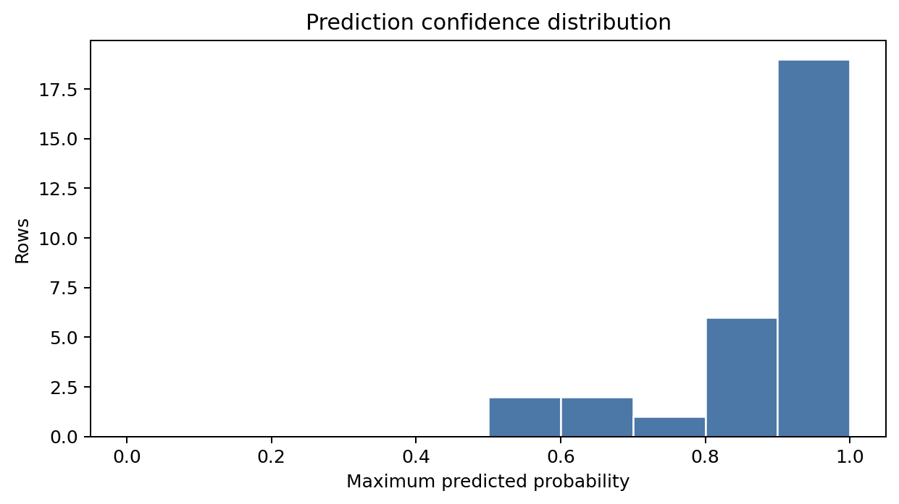

## Conclusion

The measurements predict Iris species well in this benchmark. Petal length and width provide the clearest separation, especially for setosa. The tuned linear SVM achieved **0.975 mean 5-fold CV macro F1** and **0.933 hold-out macro F1**. Logistic Regression reached 1.000 on the single hold-out split, which is encouraging but not enough to override the predeclared cross-validation selection rule on a 150-row dataset.

The main limitation is sample size: the test set contains only 30 flowers, and performance may shift with a different split or new population. A stronger follow-up would repeat stratified nested cross-validation or collect a larger independent dataset. Treat these scores as evidence on this classic dataset, not a guarantee of deployment performance.

## Reproduce the results

Install the project dependencies, then run from the repository root:

```powershell
python -m pip install -e .
python scripts/profile_data.py
python scripts/export_notebook_figures.py
python scripts/train_compare.py
python scripts/score_model.py --input Iris.csv
```

For scoring a new batch, provide the four measurement columns. `Species` is optional; without it, predictions and drift are produced but labelled performance metrics cannot be calculated. The guided notebook is [`notebooks/iris_modeling.ipynb`](notebooks/iris_modeling.ipynb), and the starting notebook is preserved at [`notebooks/iris_modeling_original.ipynb`](notebooks/iris_modeling_original.ipynb).

## Project map

| Path | Contents |
|:--|:--|
| [`scripts/`](scripts/) | Profiling, notebook-image export, model tuning, SHAP, and scoring entry points |
| [`src/iris_model/`](src/iris_model/) | Reusable data, evaluation, explanation, and monitoring code |
| [`reports/figures/`](reports/figures/) | EDA, evaluation, explanation, and extracted notebook figures |
| [`reports/model_comparison.csv`](reports/model_comparison.csv) | Cross-validation model ranking and selected parameters |
| [`reports/test_model_comparison.csv`](reports/test_model_comparison.csv) | Final metrics for each tuned model on the hold-out set |
| [`reports/hyperparameter_trials_svm.csv`](reports/hyperparameter_trials_svm.csv) | SVM tuning trials; equivalent CSVs are available for the other models |
| [`reports/data_profile.md`](reports/data_profile.md) | Generated data-quality and EDA summary |
| [`reports/training_summary.json`](reports/training_summary.json) | Selected model, split sizes, and headline evaluation metrics |
